# Grand Hyatt Singapore Demo: operator guide

How to run the demo and all of its scenarios. About 25 minutes for the main path, 10-15 minutes more for the second part (P1-P6), and 5 minutes for the desktop part (D1-D3).

**The demo is given from the DesignerWorks desktop app only** (macOS or Windows; installation in [README.md](README.md)). Do not use a web browser.

- **On the presenter's computer:** the app keeps the document files in `hsg-files/` next to itself. It converts, previews and OCRs them there.
- **On the demo server:** people, permissions, workflows, AI sorting and the assistant. Its address, `https://demo.adaptif.co.id`, is built into the app.

Routes in `code` (such as `/purchases`) name the app's pages. In the app you reach them from the side menu, since the window has no address bar.

> The screenshots show the app's pages as they appear inside the desktop window. They were taken with the stand-in AI, so recommendation and answer texts are simpler than with the real AI. **Red numbered boxes show where to click**; the notes under each figure say what each number is.

## Run the demo

1. **Start the desktop app** and sign in (see Logins). The bottom bar turns to **AI Active** (green) once you are signed in and connected. The demo data is prepared, and every scenario below is ready to run.
2. **Start from a clean demo.** As `demo.admin`, press **Reset demo** at the foot of the side menu, type `RESET` and confirm.
   - The server and this computer's document files return to the starting state together.
   - After about a minute the app asks you to sign in again.
   - Do this before every audience, so the prepared purchases are in their stated states.
3. **Check System health.** As `demo.admin`, open **Home -> System health**: no failed jobs. Then open **Settings** (bottom bar) -> **Document files**: it should read "Kept on this computer in ... (file helper idle)".
4. **To switch person**, stay as `demo.admin` and use **User menu -> View as...**, or sign out and sign in as the other person. One app window shows one person at a time.
   - To show two people side by side, for example the bell counting up live, run the app on a second computer.
5. **Keep `demo-uploads/` at hand.** These files are uploaded live:
   - `handover-kitchen/`: ten handover files with meaningless names;
   - `messy-dump.zip`: 32 mixed files;
   - `scanned-washer-manual.pdf`: a three-page scan with no text layer.

   Drag them from Finder or Explorer onto the upload area of the app window, or use the area's file picker.

## Logins

Password for everybody: **`[removed]`**. Ask the demo owner for it.

| Person | Login | Role in the story |
|---|---|---|
| Siti Rahman | `siti.rahman` | Purchaser: starts purchases, uploads quotes, answers Q&A cards |
| Marcus Lim | `marcus.lim` | Purchasing head: approves awards below SGD 50,000 |
| Daniel Tan | `daniel.tan` | General Manager (director): approves large awards, overrides, cancels, corrects the AI |
| Benjamin Koh | `benjamin.koh` | M&E engineer: permit to work, disposal and handover uploads |
| Raj Kumar | `raj.kumar` | Chief Engineer: approves permits, disposals, handover |
| Nur Aisyah | `nur.aisyah` | Accounts payable: uploads vendor invoices |
| Grace Chua | `grace.chua` | Director of Finance: approves invoices, budget |
| Rosalind Goh | `rosalind.goh` | Housekeeping: no engineering or finance documents, no FFnE register, workflow start or dashboards |
| Administrator | `admin` | Users, roles, departments, audit trail |
| Demo Administrator | `demo.admin` | The presenter: every permission. **Reset demo** at the foot of the side menu (also `admin`). **Everyone** in Approvals & workflows (also `/open-work`) lists every open step and question with who it waits on, and can approve, reject, complete or accept as an override. **View as...** (user menu) uses the whole app as another person (banner "Viewing as ...", **Stop viewing**); changes are audited under `demo.admin`. **System health** on Home: jobs, conversion failures (Retry), AI spend |

## Finding your way (the new interface)
The menu on the left is grouped by task and shows only what the signed-in person may use: **Home**, **My work** (Approvals & workflows, Questions, Inbox), **Procurement** (Purchases & projects, FFnE register), **Documents** (Library, Upload, AI sorting), **Insights** (Executive dashboard, Budget, Petty cash), **Assistant**, **Administration**. The top bar has the search box, the inbox bell (its number counts up live) and the user menu (My seal, Credits, View as… for administrators, Sign out). **Home** is each person's "Today": what waits for them, their questions, their purchases, recent documents. Money reads `S$ 31,200.00`, times are Singapore time. The app's own bar along the bottom of the window shows **AI Active** (signed in and connected), **Settings** (theme, offline copies, sign out, **Document files**) and **About** (versions). Without a connection the app shows the last copy it saved for the signed-in person, read-only.

## The prepared purchases (open `/purchases`, filter titles starting "Demo:")
| Title | State | Use it for |
|---|---|---|
| Combi oven replacement (completed) | completed | the whole purchase seen from the end: PO, seals, disposal, new asset |
| Walk-in chiller (director award pending) | award waits for Daniel (SGD 80,000) | seals of approval |
| Washer extractor (quotes just received) | open Q&A card | AI comparison and recommendation, human award |
| Banquet dishwasher (upload the quotes received) | new purchase; Purchasing step "Upload received quotes" is open | Siti's **Approvals & workflows** and Home "Waiting for you" are never empty; start the live quote upload here |
| Pool pumps replacement (upload the quotes received) | second new purchase, same open Purchasing step | a second task for the Purchasing department |
| Induction range replacement (permit to work pending) | permit approval waits for Raj | **cancel + rollback** live |
| Pastry chest freezers (invoice approval pending) | invoice matched to the PO | finance approval |
| Spa air handling unit (invoice does not match) | invoice total is 8% above the PO; Grace's approval shows the failed check | the "needs attention" path: the match step flags it, finance decides |
| Ballroom audio upgrade (cancelled) | cancelled, rolled back | what a rollback leaves (nothing) |
| Lobby video wall (award rejected) | stopped after a rejection | retry / cancel |
| Main kitchen refit project (handover documents pending) | project, two purchases done, waits for the handover upload | live handover upload and AI sorting |
| Pool plant refit project (handover sorting pending) | handover documents uploaded, five open Q&A cards | "Accept all recommended" |

The numbers agree across documents of one purchase: the quotes, the PO issued from the awarded quote, the permit to work and the invoice carry the same vendor, item, quantity, total and PO number. Example: freezers, 2 x SGD 3,850 = SGD 7,700 (quotes 7,700 / 8,200 / 8,840).

## What the second part uses

The demo data also contains, for the second part:

- **Workflow editor:** "Minor works approval" (approval area), version 1 (S$ 10,000 limit, retired) and version 2 (S$ 5,000 limit, active), plus one open draft. Three requests wait: two for Raj Kumar (head of Engineering), one for Daniel Tan (above S$ 5,000). The first request's task was done by the demo administrator, so the Override pill shows.
- **Budget:** FY of the anchor year, lines per department and FFnE category; IT is the one department over budget.
- **Petty cash:** five funds (one per two departments), about 20 entries, 15 generated receipts, one expense waiting for Raj Kumar.
- **Forms:** "Room inspection checklist" and "Contractor sign-in", published, 15 records each.
- **Library:** one archived document (visible with the Archived filter).
- **Permissions:** staff submit forms and read the budget; heads also design forms and edit workflows; the director publishes forms and workflows and reads every department; finance reads all and writes the budget. `demo.admin` belongs to General Management.

## Main click path (about 25 minutes)
Each step names the pain point it answers. A purchase page has the tabs **Overview** (stages, timeline with seals), **Flow** (the step graph), **Documents** and **History** (who changed what).

### 1. Scattered documents become one searchable library (scattered documents, drawings, data)
1. Log in as `siti.rahman`. **Home**, then **Documents → Library** (`/documents`): quotes, POs, permits, invoices, drawings, specs, OMM, photos, all typed and linked to assets. The folder panel groups them by document type, vendor and location.
2. Type `chiller` in the search box and press Enter: keyword and meaning search together; each hit shows its type, a snippet and a match score. Open a quote: preview on the side, or the full page with its converted text, versions and the records it is linked to. The preview and **Open original** read the file from this computer (`hsg-files/`); the server only decided that Siti may see it.
3. Sign out (user menu), sign in as `rosalind.goh` (or **View as...** Rosalind Goh), repeat the search: engineering and finance documents are not listed or counted (permission-aware everywhere), and her menu has no FFnE register, dashboards or Administration.

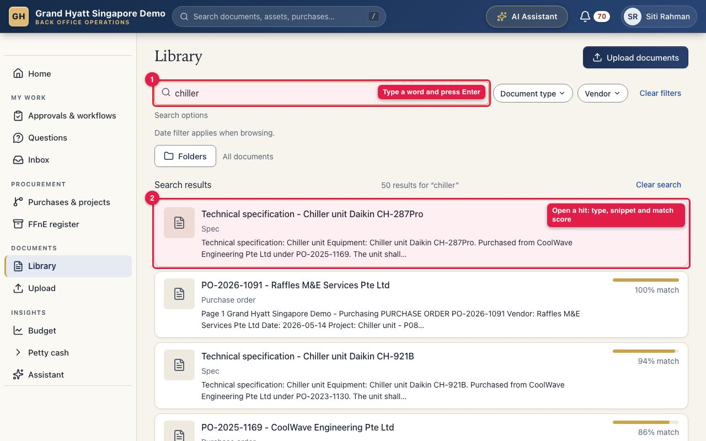

*Figure 1. Documents -> Library: search for "chiller" as Siti. ① Type a word and press Enter. ② Open a hit.*

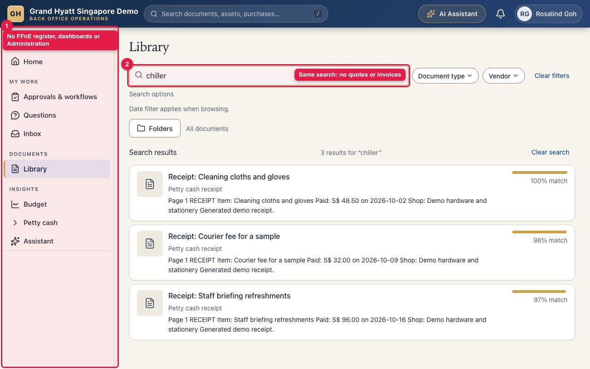

*Figure 2. The same search as Rosalind (Housekeeping). ① Her menu is shorter. ② Engineering and finance documents are not listed.*

### 2. Manual paperwork: FFnE Purchase end to end
1. As `siti.rahman` open `/purchases`, then **Washer extractor**; the **Flow** tab draws the steps, the current one highlighted.
2. `/questions`: the card "Which quote should … be awarded to?" lists the three quotes, lowest first, with a recommendation and its reason (with the real AI: Straits Laundry Systems, S$ 31,200.00, the lowest). **Accept recommendation**. The step finishes by itself and the award goes to Marcus.
3. Switch to `marcus.lim` (**View as...**, or sign out and in; with a second computer running the app as Marcus, the **bell** in the top bar counts up by itself when Siti accepts). `/inbox`: the approval request arrived; **Open step** on the entry, read the quotes, **Approve with my seal**: his seal and the date are stamped on the approval, the PO document is generated and linked (Overview tab: the seal image on the timeline).
4. As `daniel.tan` open **Walk-in chiller**: S$ 80,000.00 is above the threshold, so the approval waits for Daniel (his **Approvals & workflows**, **Approve**), not Marcus (whose list does not show it). That is the routing by amount.
5. Open **Combi oven replacement (completed)**: every step is green, with seals, a PO equal to the winning quote (S$ 48,000.00), the old oven disposed and the new asset registered (`/ffne`, search `FFNE-`).

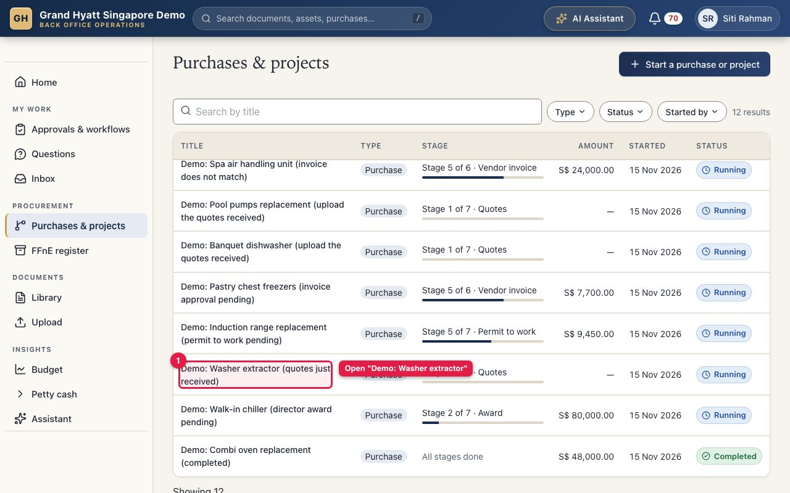

*Figure 3. Purchases & projects: the prepared "Demo:" purchases. ① Open the washer extractor purchase.*

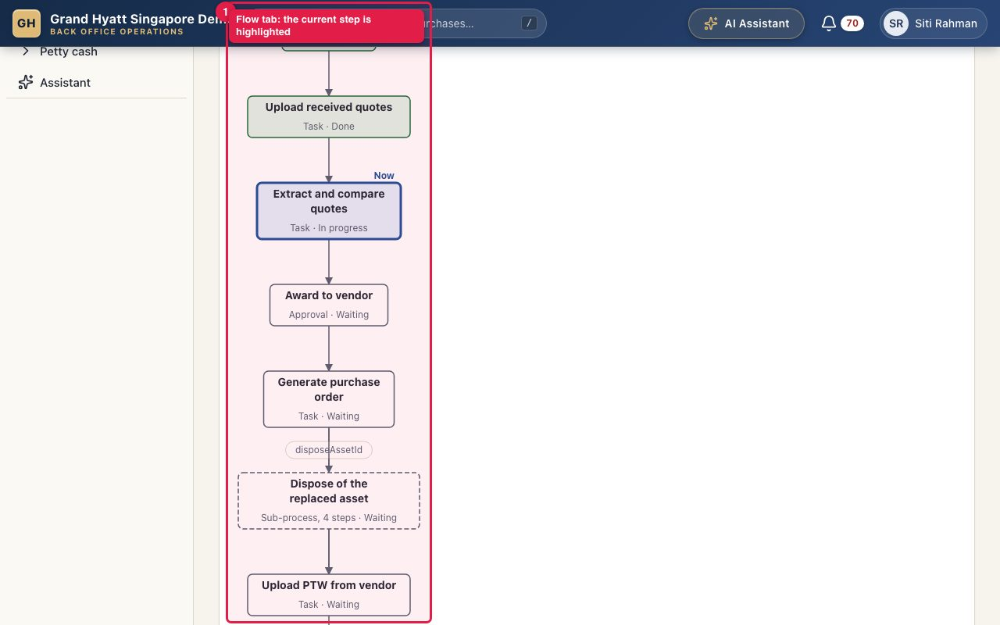

*Figure 4. The Flow tab draws the steps of the purchase. ① The current step is highlighted.*

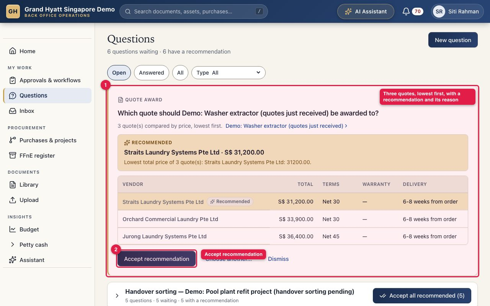

*Figure 5. Questions: which quote should the washer extractor be awarded to?. ① The three quotes with the AI recommendation. ② Accept recommendation.*

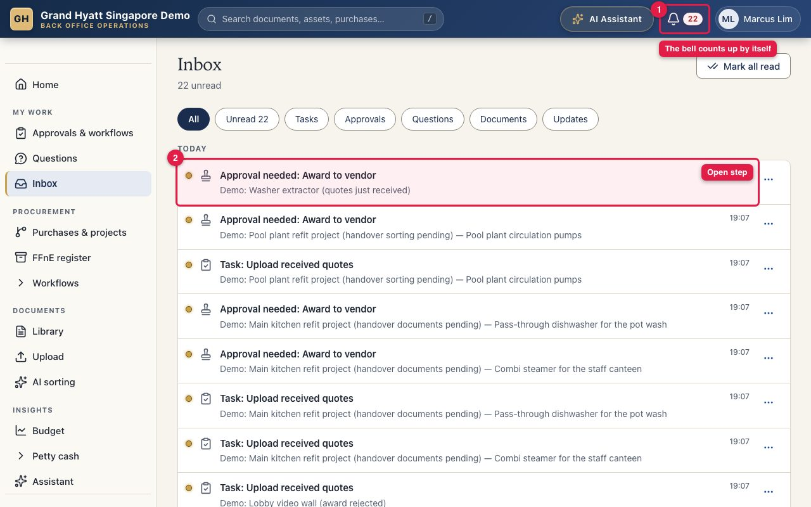

*Figure 6. Marcus's inbox: the approval request arrived. ① The bell number grows without a reload. ② Open step.*

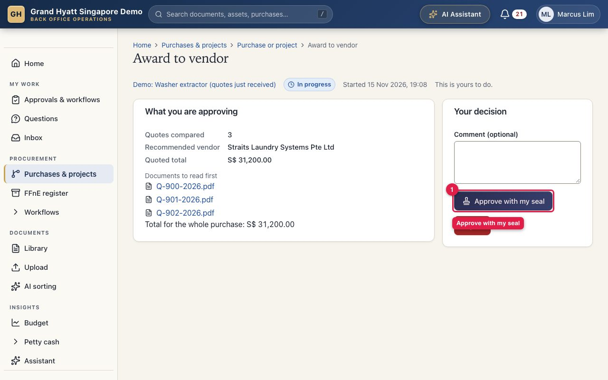

*Figure 7. The approval step: read the quotes, then approve with the seal. ① Approve with my seal.*

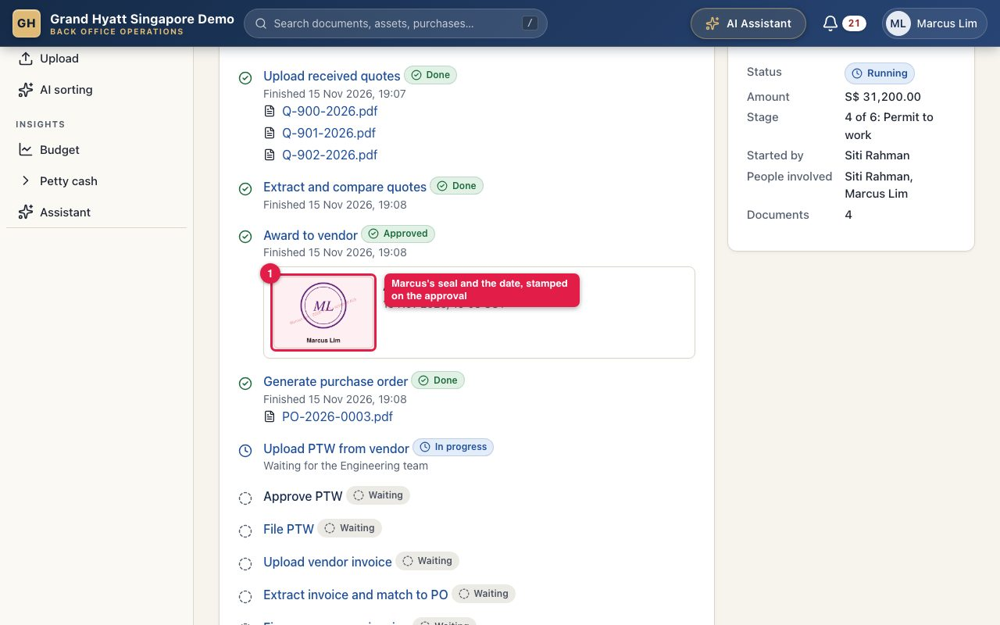

*Figure 8. Overview tab: the seal on the timeline. ① Marcus's seal and the date.*

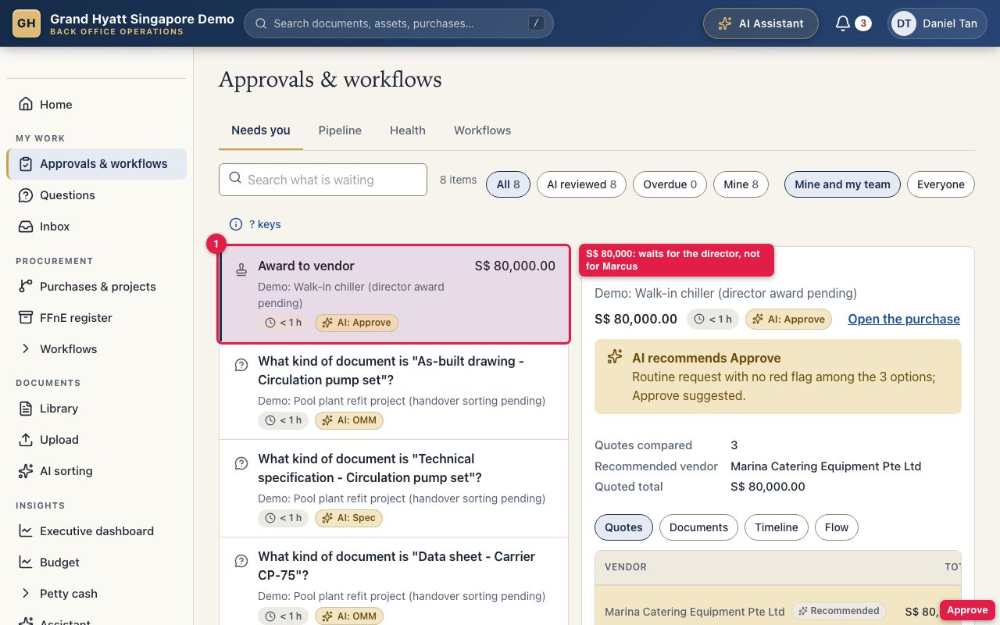

*Figure 9. Daniel's Approvals: the walk-in chiller award waits for him. ① The award above the threshold. ② Approve.*

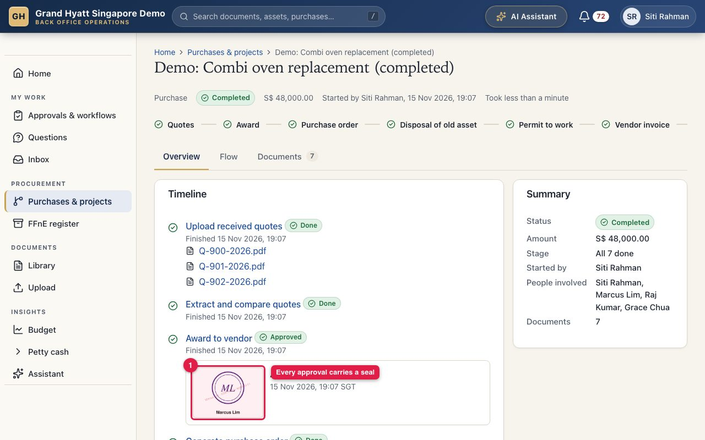

*Figure 10. Combi oven replacement (completed): every step done, with seals. ① Seals of the approvers.*

### 3. Manual approval routing and the inbox
1. As `raj.kumar`: **Approvals & workflows** (`/approvals`) lists the permit for the induction range; as `grace.chua` the freezer invoice (and the spa unit). Open the freezer step: the checks read "Vendor matches the order", "Amount matches the order", "Order number matches" (S$ 7,700.00).
2. Approve the invoice as `grace.chua`. The AI pre-fills the new asset (name, brand, model, serial from the invoice); the card in `/questions` asks the category. Accept: the asset appears in `/ffne` linked to the invoice, permit and quotes.
3. Open the **Spa air handling unit** step as `grace.chua`: "Amount does not match the order (invoice S$ 25,920.00, order S$ 24,000.00)": the AI flags it, the human decides (**Reject** with a reason or approve anyway).

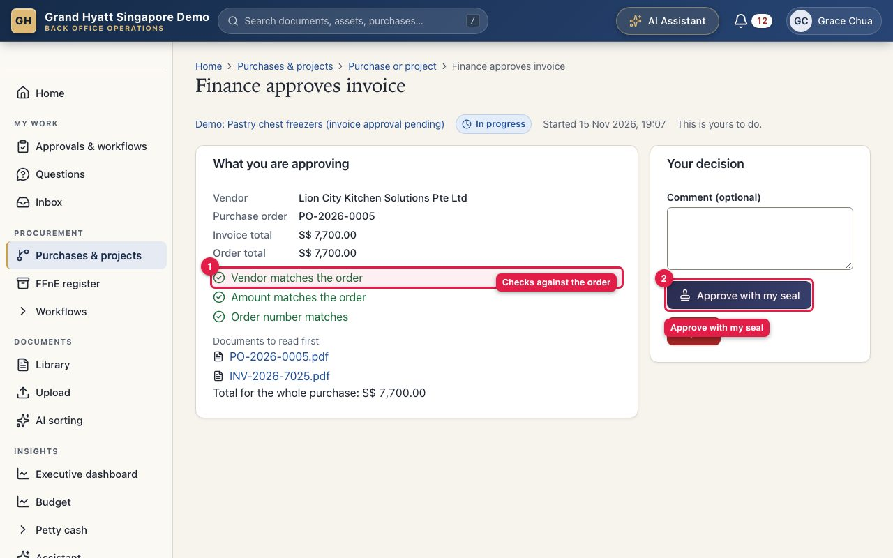

*Figure 11. Invoice approval (freezers): vendor, amount and order number match. ① The checks against the order. ② Approve with my seal.*

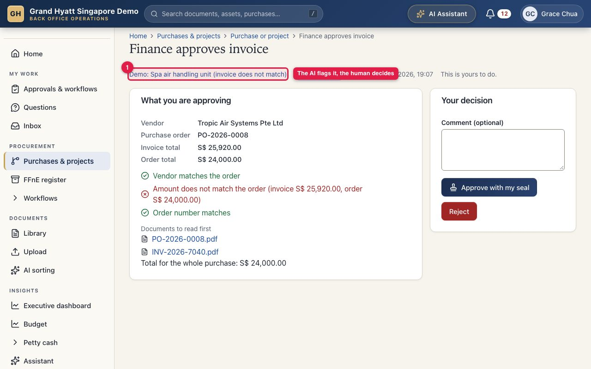

*Figure 12. Spa air handling unit: the invoice is 8% above the order. ① Needs attention.*

### 4. Inconsistent governance: audit and cancel with rollback
1. As `daniel.tan` open **Induction range replacement (permit to work pending)**. Note in `/ffne` that the old range is *disposed* and a PO exists.
2. **Cancel purchase** (top right): the dialog explains that what the process changed is undone. Confirm with **Cancel and undo its changes**. Reload `/ffne`: the old range is active again and the PO is gone. Compare with **Ballroom audio upgrade (cancelled)**, which shows the final state of a cancelled instance.
3. As `admin`: **Administration → Audit trail** (`/admin`): every change with who, when, before and after, and a **Restore** per change; **Checkpoints** marks a moment to go back to.
4. Open **Lobby video wall (award rejected)**: a rejection stops the instance; the starter or Daniel can **Try this step again** or cancel.

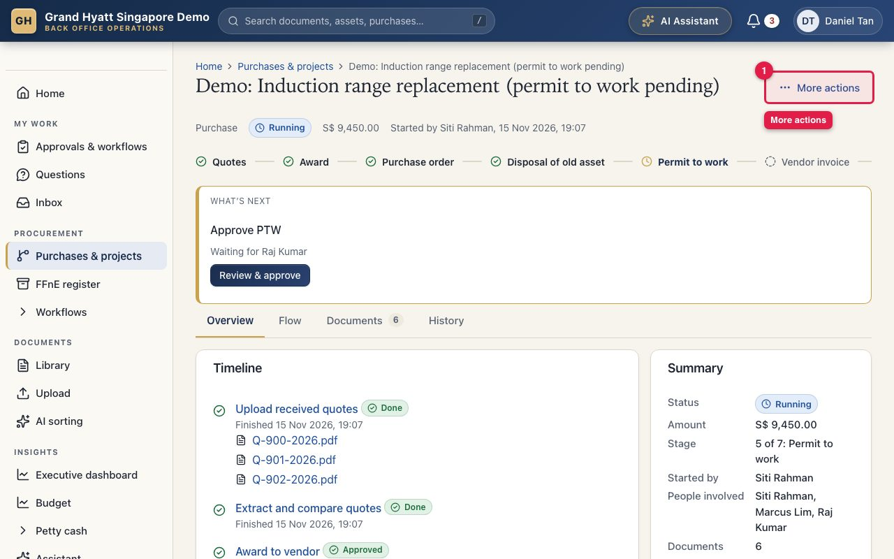

*Figure 13. Induction range replacement: the permit waits, the old range is already marked disposed. ① More actions.*

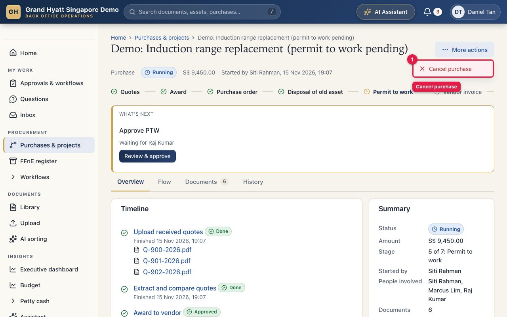

*Figure 14. More actions -> Cancel purchase. ① Cancel purchase.*

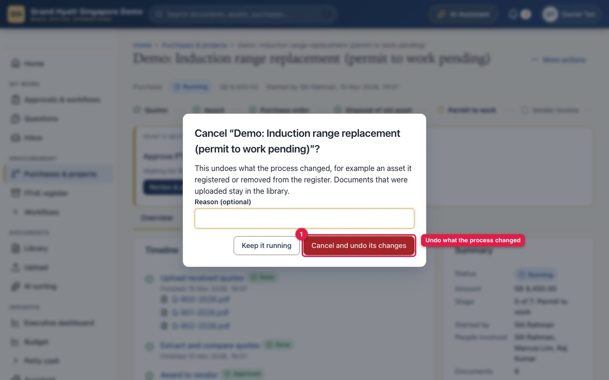

*Figure 15. The dialog explains what is undone. ① Cancel and undo its changes.*

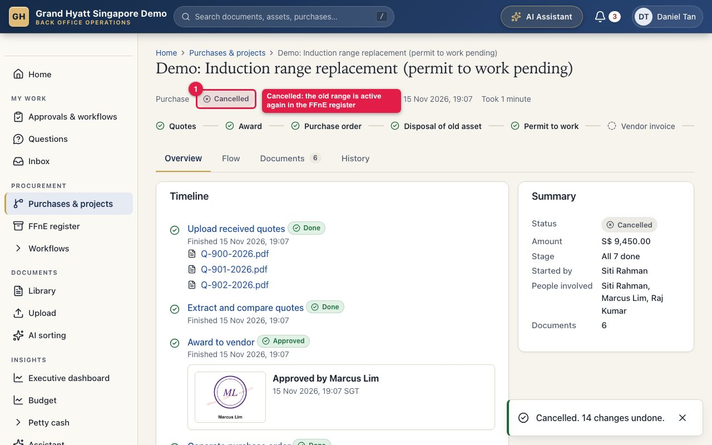

*Figure 16. After the cancel: the purchase is cancelled and its changes undone. ① Cancelled.*

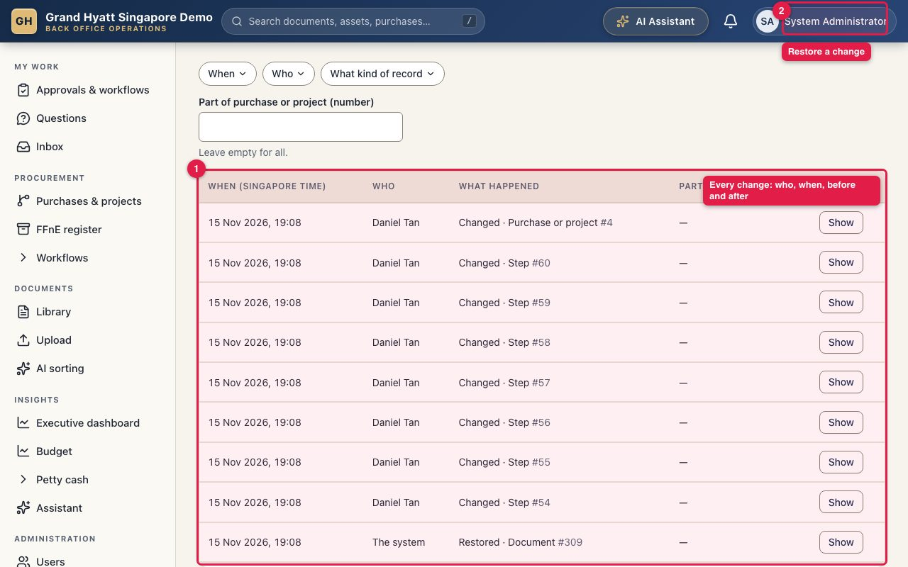

*Figure 17. Administration -> Audit trail. ① Who, when, before and after. ② Restore.*

### 5. FFnE Project and the handover (manual retrieval of project documents)
1. As `benjamin.koh` open **Main kitchen refit project** from **Purchases & projects** (the **Open** button of the Handover step): both purchases are done, the Handover step waits for an upload.
2. Drag the ten files of `demo-uploads/handover-kitchen/` onto the upload area of that step, then **Mark step complete**. The files are stored and converted on this computer; the steps wait by themselves for documents that are still converting (a few seconds) and continue when done. Press **Try this step again** only if a conversion failed for good.
3. As `siti.rahman` (the starter; the cards are assigned to them), `/questions`: a batch of ten cards, one per file ("What kind of document is …"), each with a recommendation. **Accept all recommended (10)**, confirm with **Accept all**. The documents get their types and are linked to the new assets; Raj approves the handover (**Approve with my seal**).
4. For the finished version of this step open **Pool plant refit project**: five cards are waiting; accept them in one click.

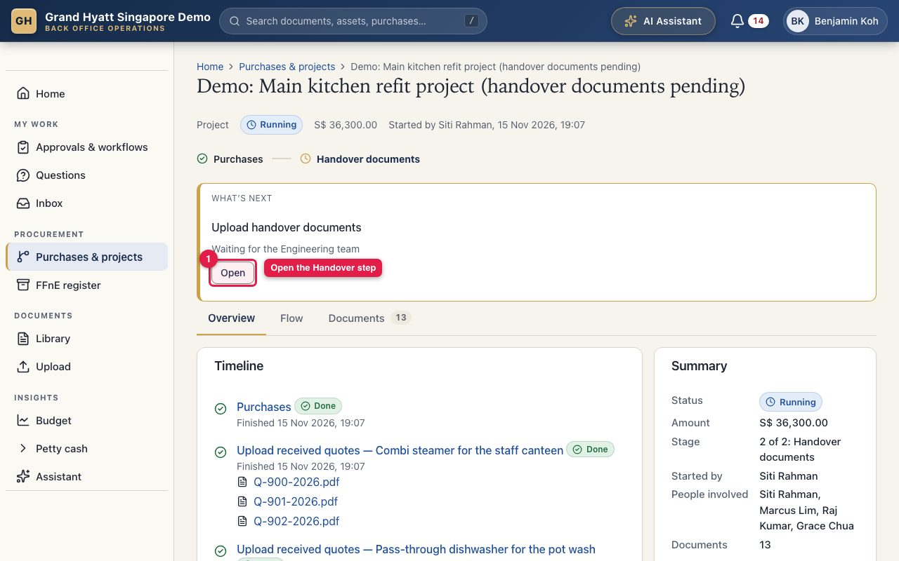

*Figure 18. Main kitchen refit: the Handover step waits for an upload. ① Open.*

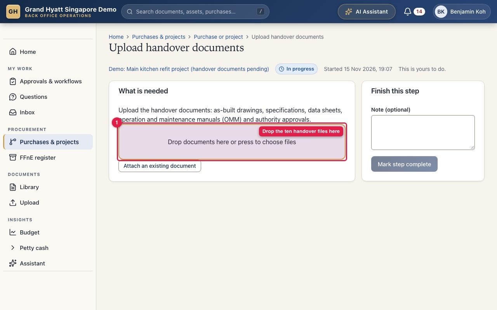

*Figure 19. The Handover step: drop the files. ① Drop the files.*

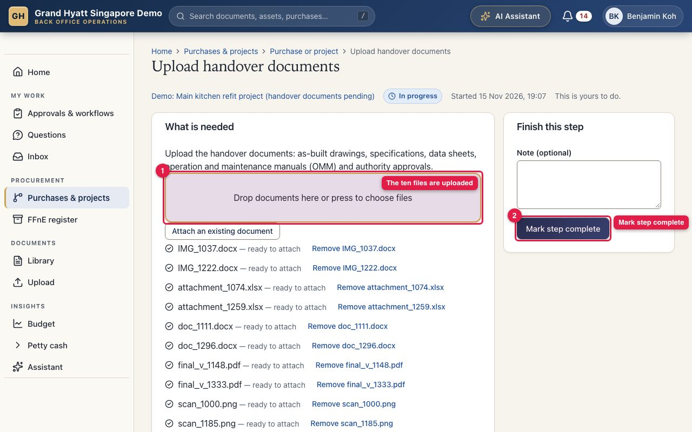

*Figure 20. Ten files uploaded, then Mark step complete. ① Files uploaded. ② Mark step complete.*

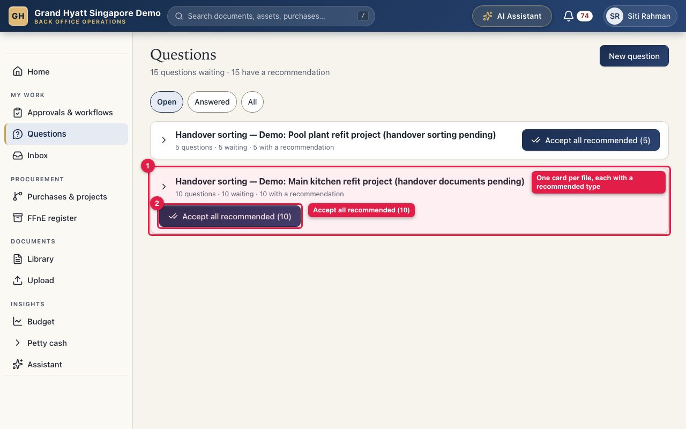

*Figure 21. Siti: ten cards, one per file, with the AI recommendation. ① One card per file. ② Accept all recommended (10).*

### 6. AI sorting: the messy dump (scattered documents, nightmare scenario)
1. **Upload without approval (the default).** As `siti.rahman`, open **Documents → Upload** (`/documents/upload`).
   - The switch **Upload without approval** is on: the files skip approval, and the AI files every document into a folder by itself, creating a new folder when none fits.
   - Drag `demo-uploads/messy-dump.zip` onto the upload area and press **Upload and file automatically**.
   - The app unpacks the zip and converts the 32 files on this computer; the server sorts them.
   - After a minute or two the documents sit in their folders in the **Library**.
   - Files the AI was unsure about are listed on the tab **Files with low confidence**: check one, or move it to another folder.
2. **With an approval (the governed path).**
   - Upload again with **Upload without approval** switched off. Under **Change options**, choose **AI sorting → Also propose new folders** and tick *Make searchable by meaning (AI index)*, then **Upload and submit for approval**.
   - Switch to `marcus.lim`, open the **Review queue** tab, open the batch and **Approve**. The sorting cards go to the approver (Marcus gets read/write access to the documents he released), so stay as `marcus.lim`.
   - Open `/sorting`: the group for the batch holds one suggestion per file (folder, confidence, what the AI read). Press **Accept all suggestions (N)** to sort them. With real keys the AI mostly fits the existing folders, so *New folders suggested by AI* (rework by `admin`: confirm, rename, move, merge) can stay empty for this dump.
3. **Sort into the folders that exist.**
   - The demo data contains a ready-made dump of 32 unsorted documents (generic folder, nothing linked). The "N documents not sorted yet" line on `/sorting` counts only these.
   - Press **Sort the unsorted documents**, choose the scenario and **Start sorting**. Suggestions appear over a minute or two; then accept them.

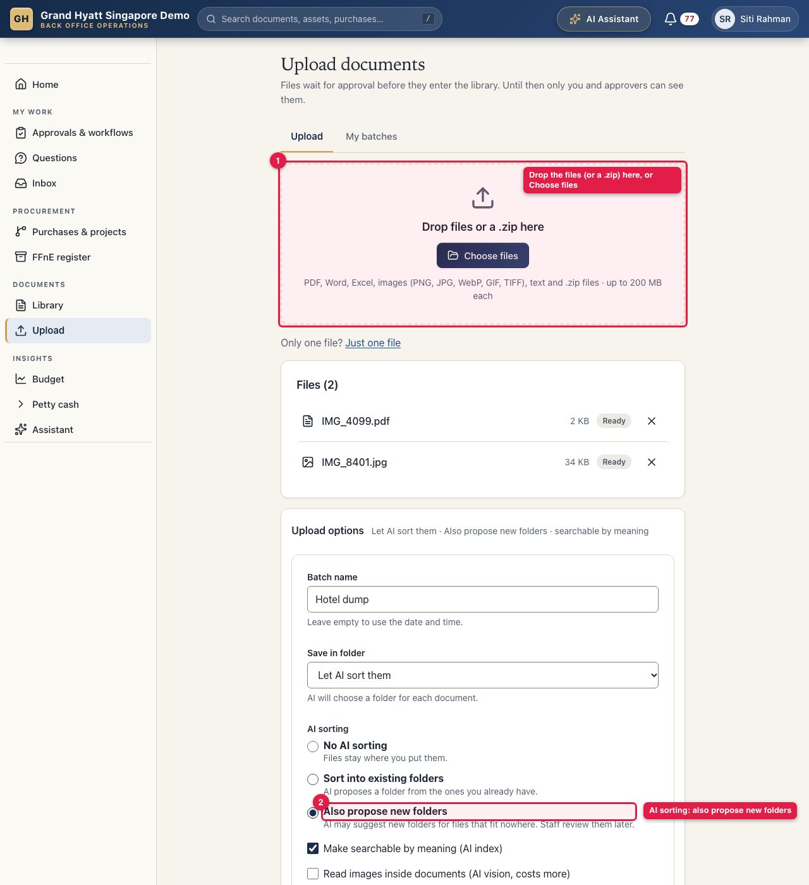

*Figure 22. Documents -> Upload: the messy dump with AI sorting. ① Drop the files. ② AI sorting: also propose new folders.*

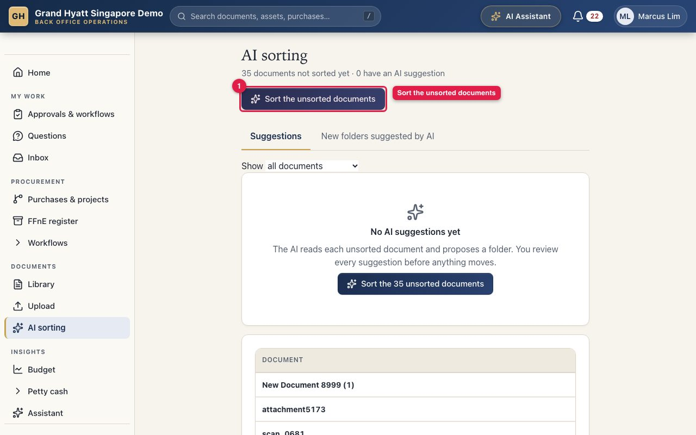

*Figure 23. AI sorting: the seeded dump of unsorted documents. ① Sort the unsorted documents.*

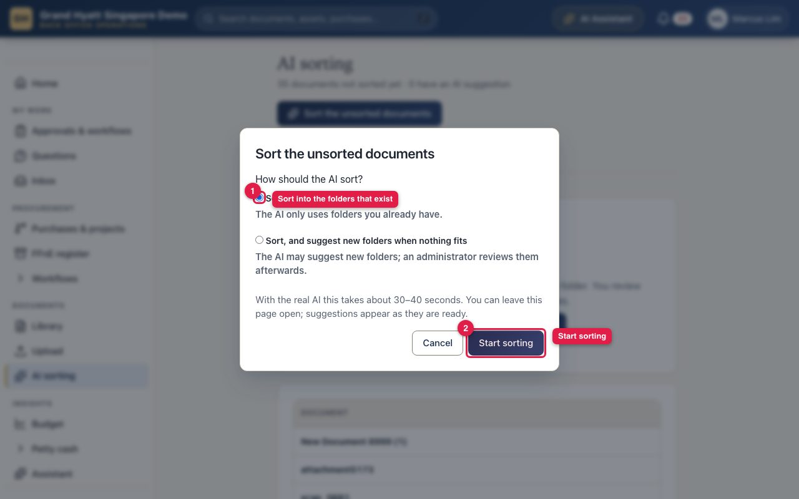

*Figure 24. Choose the sorting mode and start. ① Sorting mode. ② Start sorting.*

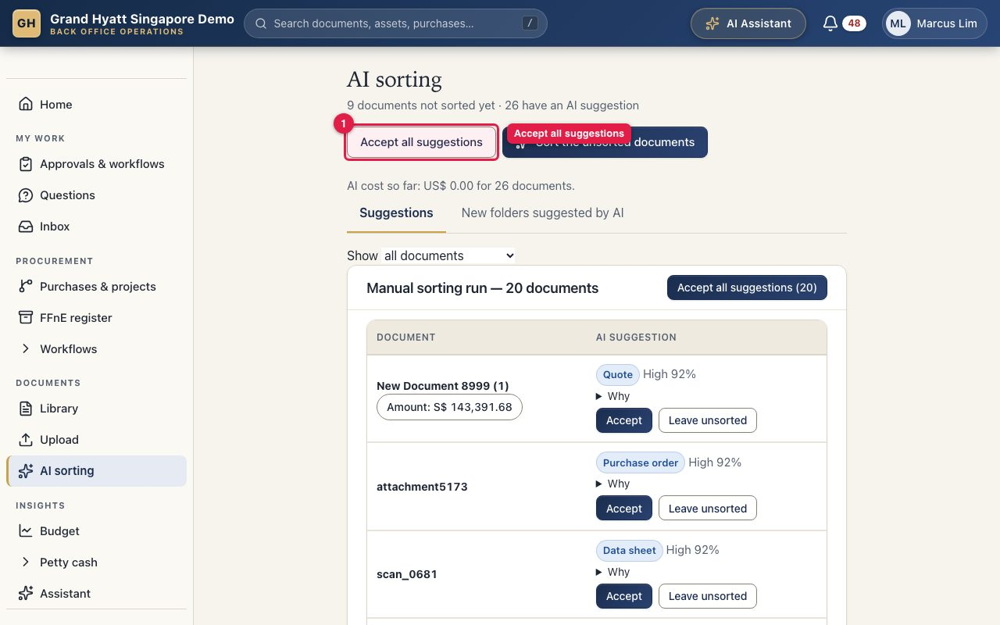

*Figure 25. AI sorting: one suggestion per file (folder, confidence). ① Accept all suggestions.*

### 7. Lost know-how: ask the knowledge base (manual retrieval)
In `/assistant` as `siti.rahman`, ask:
- "Which vendors quoted for the walk-in chiller and at what price?"
- "Show me the permit to work for the pool circulation pumps." (answers cite the document; open the citation)
- "What does the operation manual say about daily checks for the combi steamer?"
- "How many assets do we have and which leases end soon?"
Then log in as `rosalind.goh` and ask the first question again: the answer says it found nothing and cites nothing she may not read.

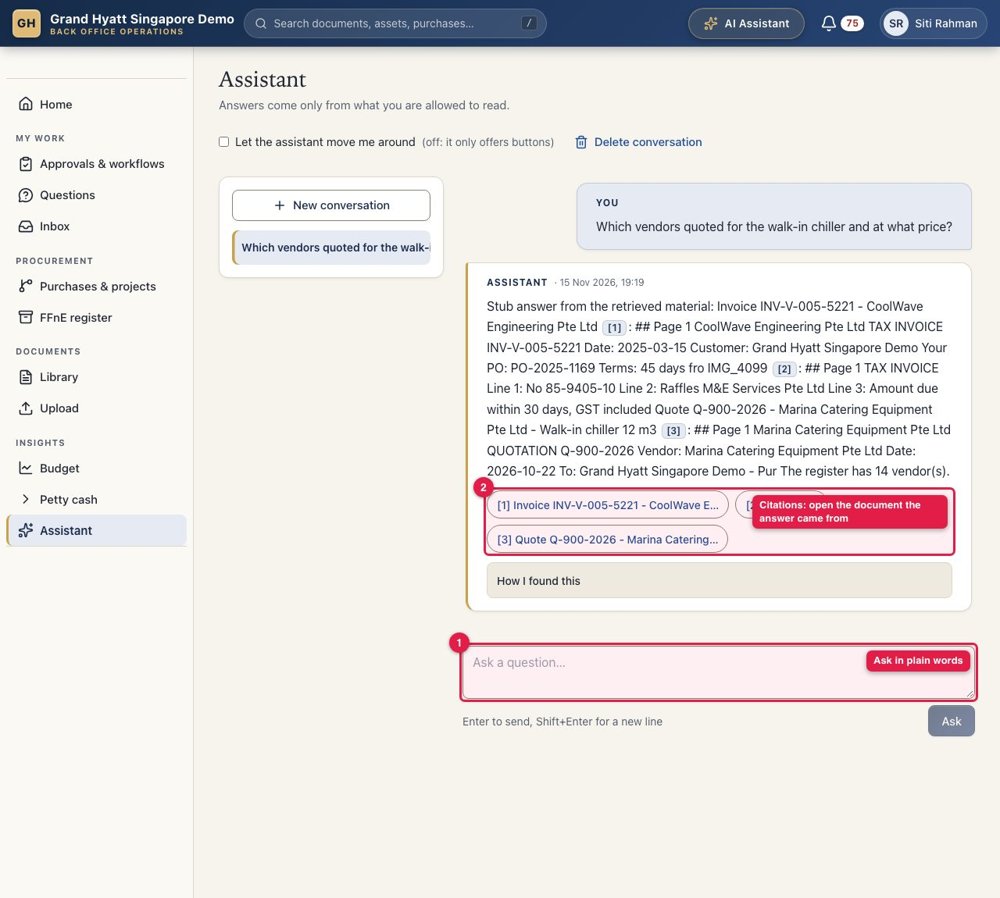

*Figure 26. Assistant: which vendors quoted for the walk-in chiller?. ① Ask a question. ② Answer with citations.*

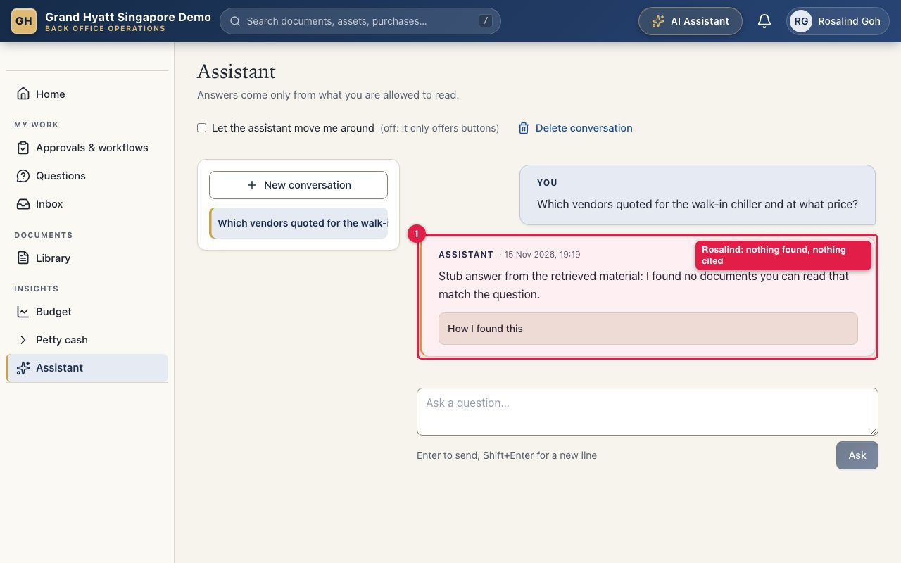

*Figure 27. The same question as Rosalind: nothing she may not read. ① No citations.*

### 8. Management view
1. As `daniel.tan`: **Insights → Executive dashboard** (`/insights/executive`): inventory by category and location, purchase cost, leasing per month, trends, open workflows.
2. **Approvals & workflows → AI reviewed** (`/approvals?filter=ai`): pending approvals, each with an AI mark (approve / reject, with reason). Disagree with one (give a reason) and decide the other way: the correction is stored and the most similar corrections are added to the AI prompt next time (no training).

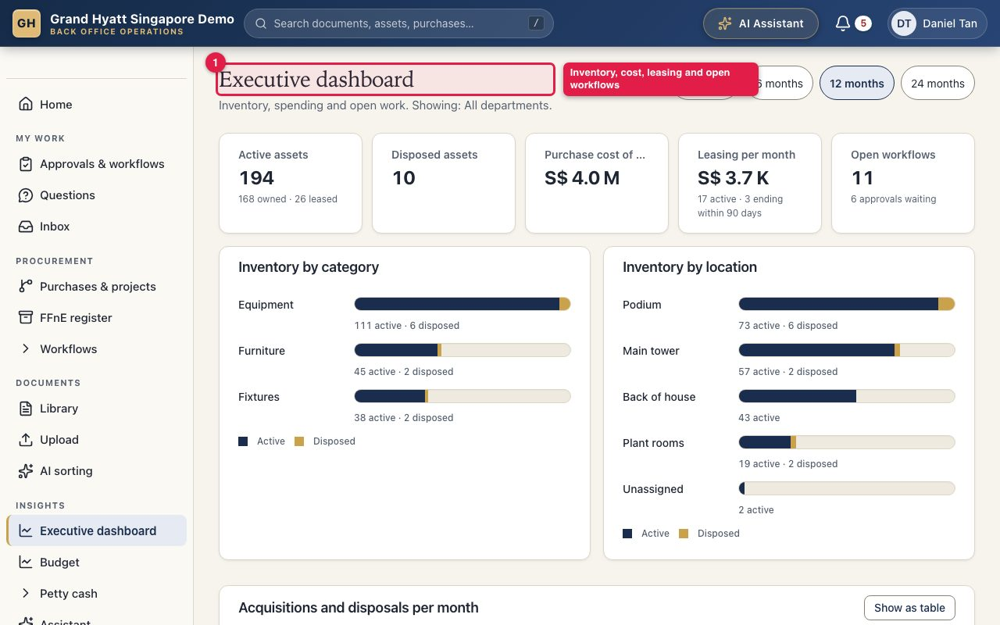

*Figure 28. Insights -> Executive dashboard. ① The management view.*

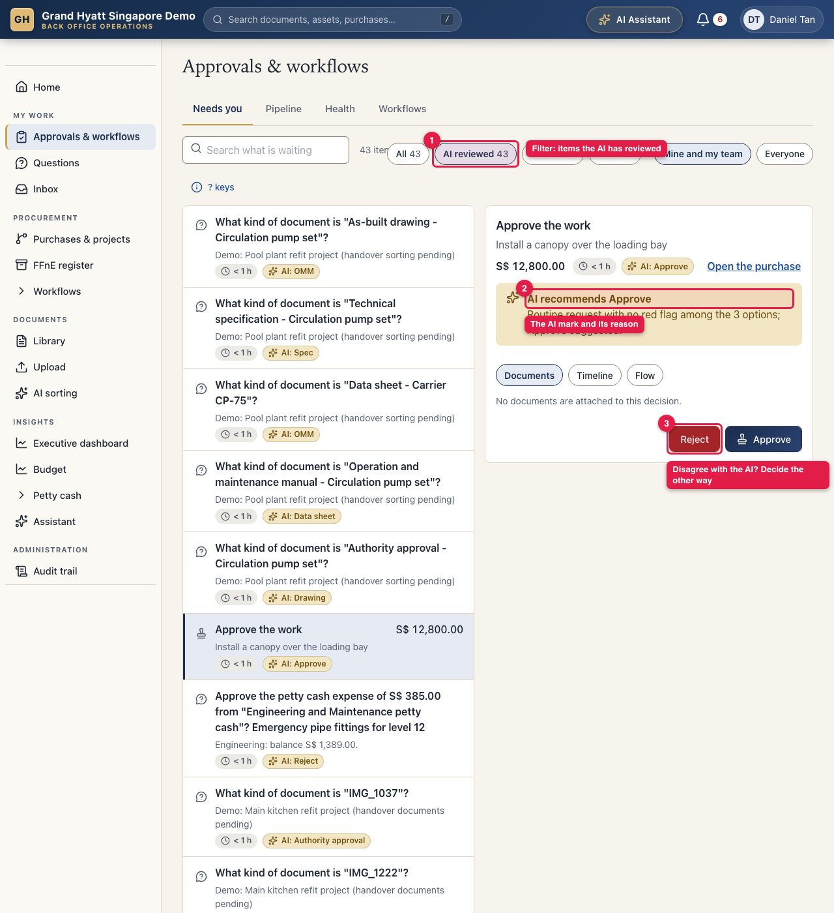

*Figure 29. Approvals -> AI reviewed: every item carries an AI mark and reason. ① AI reviewed filter. ② AI mark and reason. ③ Reject or Approve.*

### 9. The presenter's own view: demo administrator
1. Log in as `demo.admin`. **Home** shows *System health*: background jobs, conversion failures (with Retry) and AI spend (US$, Singapore-time days), plus the latest audit rows.
2. **My work → Approvals & workflows → Everyone** (`/open-work`): every open step and every open question with who it waits on. **Approve as override**, **Reject as override**, **Complete as override** and **Accept recommendation as override** act on any of them with the administrator's seal and are recorded as overrides. Use it to move the story along without logging out.
3. User menu → **View as…** → choose `Siti Rahman` → **Start viewing**: the whole app is Siti's (her Home, menu, lists); the gold banner "Viewing as Siti Rahman" stays on every page. Do something (answer a card), then **Stop viewing**. **Administration → Audit trail** shows the change under `demo.admin` with Siti as the person acted as.

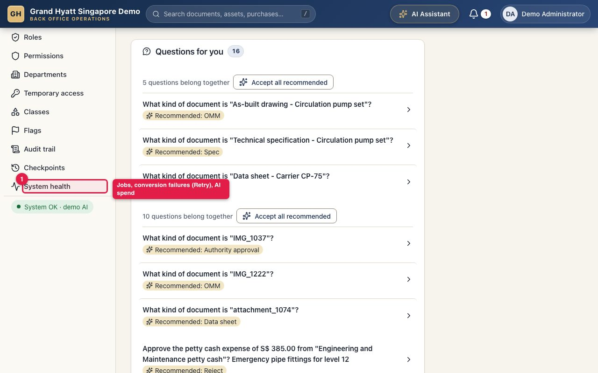

*Figure 30. Demo Administrator's Home: System health. ① System health.*

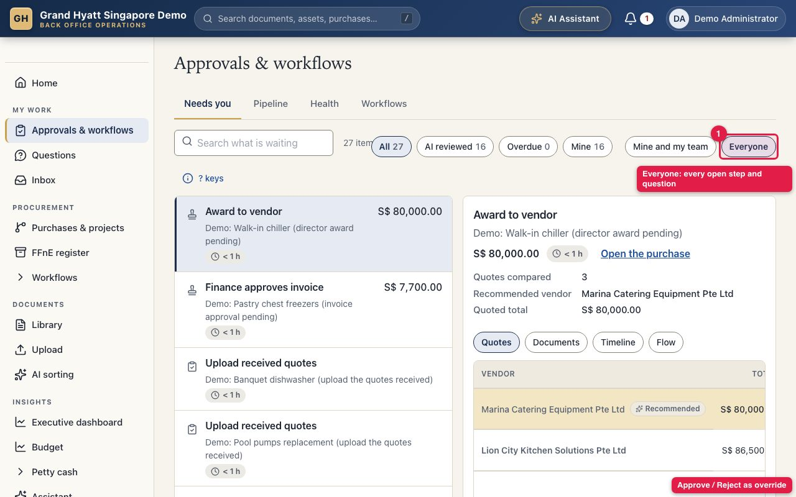

*Figure 31. Approvals -> Everyone (All open work): the override buttons. ① Everyone. ② Override.*

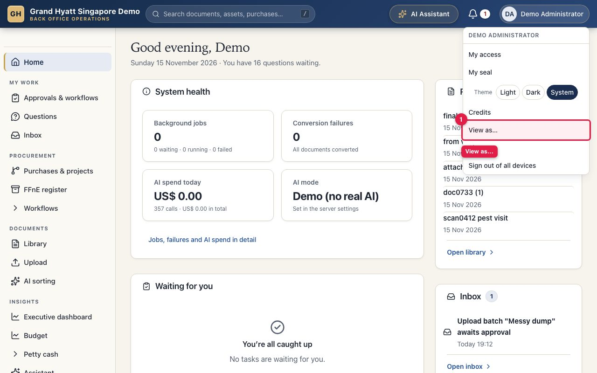

*Figure 32. User menu -> View as…. ① View as….*

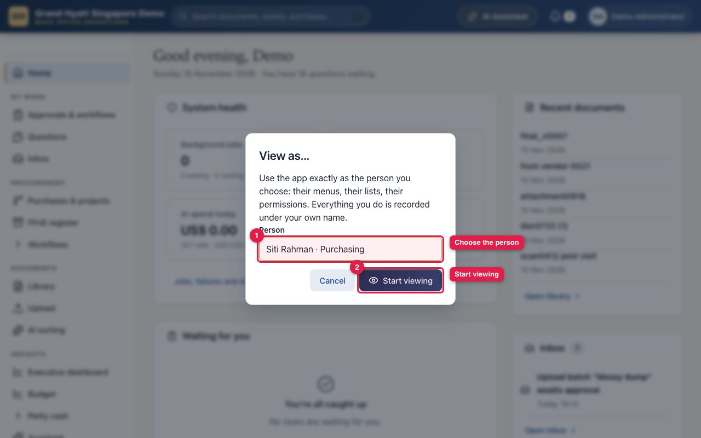

*Figure 33. View as…: choose Siti Rahman. ① Choose the person. ② Start viewing.*

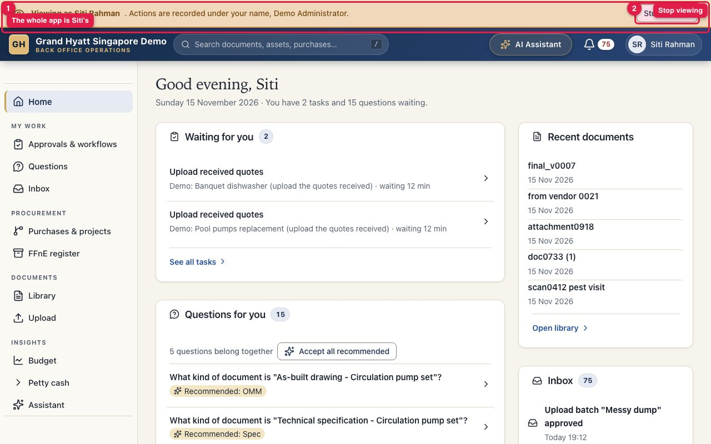

*Figure 34. Viewing as Siti Rahman: banner on every page. ① Banner. ② Stop viewing.*

## Desktop part: D1-D3 (5 minutes)
What the desktop app adds: the documents never leave the presenter's computer, scans are read offline, and one button resets everything.

### D1. Your files stay on this computer (2 min) · `siti.rahman`
1. Open **Settings** (bottom bar) → **Document files**. It shows where the files are kept (the `hsg-files` folder next to the app) and how much file work is waiting.
2. Take the handover files you uploaded in scenario 5, or upload any document of your own from **Documents → Upload**. (The same file uploaded twice is refused as a duplicate.)
   - Each file went into `hsg-files/` on this computer, and the app converted it there.
   - The server receives the text it needs for search and sorting, never the file.
   - Open the document in the **Library**: the preview and **Open original** read the local file.
3. Point out the split: people, permissions, workflows, the AI sorting and the assistant run on the server; the files and the file work stay here.

### D2. A scanned manual, read offline (2 min) · `siti.rahman`
1. **Documents → Upload**, keep **Read images and scanned pages (AI vision, costs more)** *off* (the default; it is under **Change options**), and upload `demo-uploads/scanned-washer-manual.pdf`.
   - The three pages are photos with no text layer.
   - The app reads them on this computer with text recognition (OCR): offline, free, about a second per page.
2. Open the document in the **Library**: its text shows the model "WX-60", the daily checks and the fault codes (E01 to E09). Search `fault codes` finds it.
3. **Optional:** upload it once more with **Read images and scanned pages** on. The AI reads the pages instead. This is better for photos and handwriting, but it costs AI time and money.
4. Ask the **Assistant**: "What should be checked daily on the WX-60 washer extractor?" The answer cites the scanned manual.

### D3. Reset demo: server and files together (1 min) · `demo.admin`
1. **Reset demo** at the foot of the side menu. The dialog lists what will be lost since the last reset. Type `RESET` and confirm.
2. The server restores its starting data. The app shows "Syncing demo files with the server..." and restores `hsg-files/` from the `golden/` copy next to it, so the uploads of D1 and D2 are gone here too.
3. Sign in again: everything is as at the start.
   - A second computer running the app notices the reset at its next connection and restores its own files the same way.
   - If the server holds newer demo data than this copy of the app, the app refuses the reset before anything changes and says "Update the desktop app".

## Second part: P1-P6 (10-15 minutes)
Run after the main click path, or on its own.

### P1. Change a workflow without a programmer (3 min) · `marcus.lim`, then `daniel.tan`
1. **Procurement → Workflows** (`/approvals/workflows`, tab *Workflows* of Approvals & workflows) → **New workflow** → pick the template *Simple approval*, give it a name, choose who approves ("Head of a department") with an amount band at S$ 25,000.
2. **Try it** with S$ 30,000: the simulation names the approvers the request would reach. Back in the editor, select the approval step, change the limit to S$ 20,000 and **Try it** again with S$ 22,000.
3. **Compare**: for a new workflow it says "This is a new workflow, so everything in it is new". **Send for publishing**.
4. As `daniel.tan` (director) open the same draft → **Publish** (the published version is never edited in place; a new edit makes a new version). Then **Purchases & projects → Start** and pick the new workflow in the workflow picker: the request starts and shows its stages.

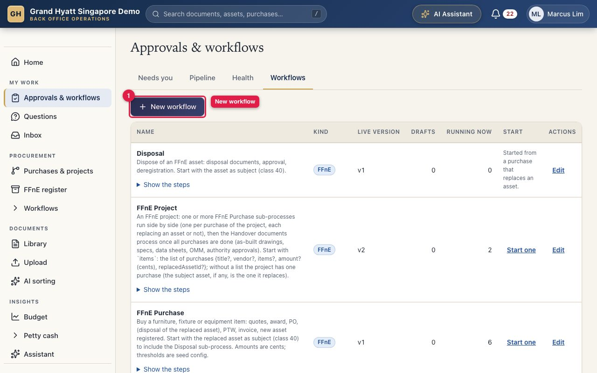

*Figure 35. Procurement -> Workflows: start a new workflow. ① New workflow.*

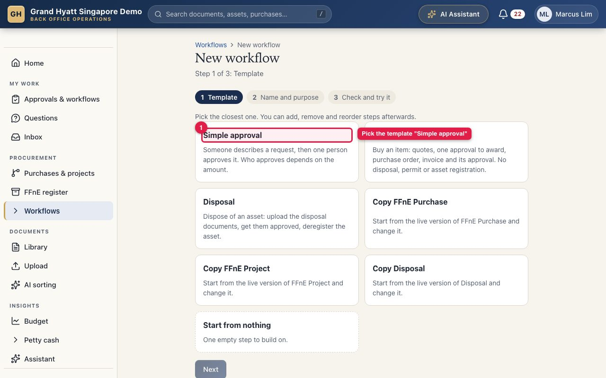

*Figure 36. New workflow: choose a template. ① Simple approval.*

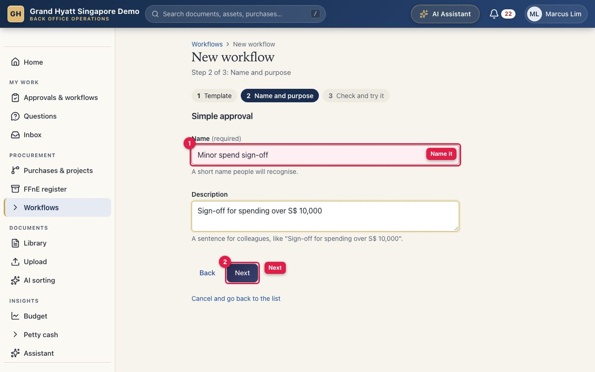

*Figure 37. Give the workflow a name. ① Name. ② Next.*

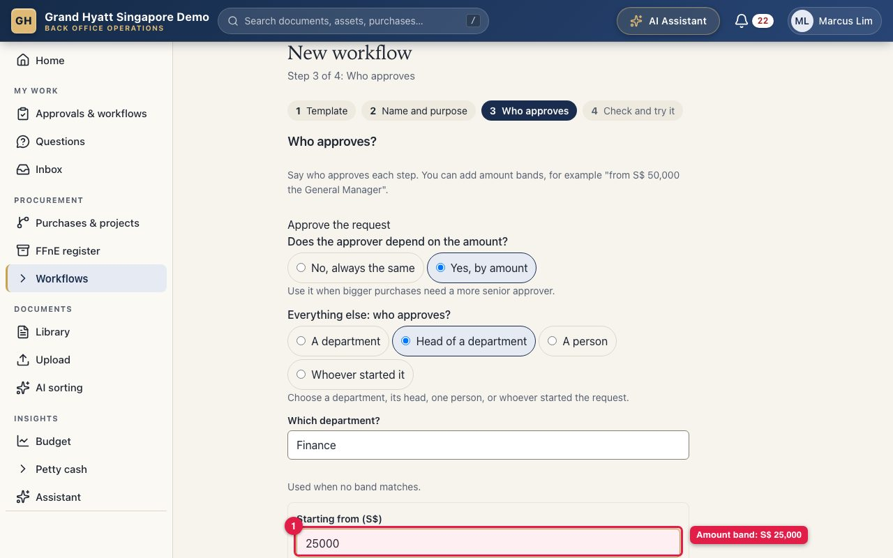

*Figure 38. Choose who approves, with an amount band. ① Amount band.*

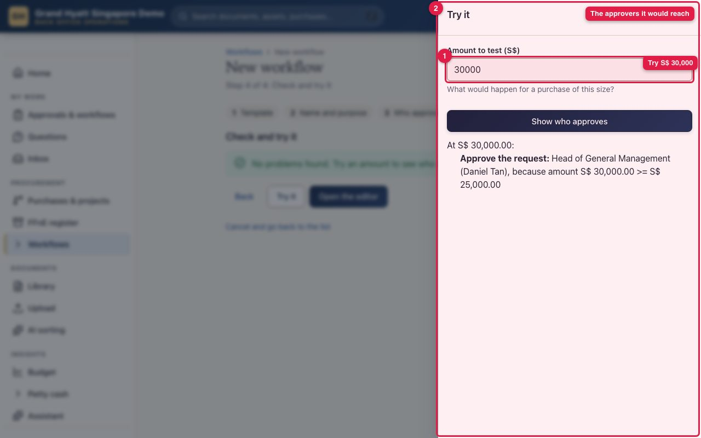

*Figure 39. Try it: who would approve S$ 30,000?. ① Amount. ② The simulation result.*

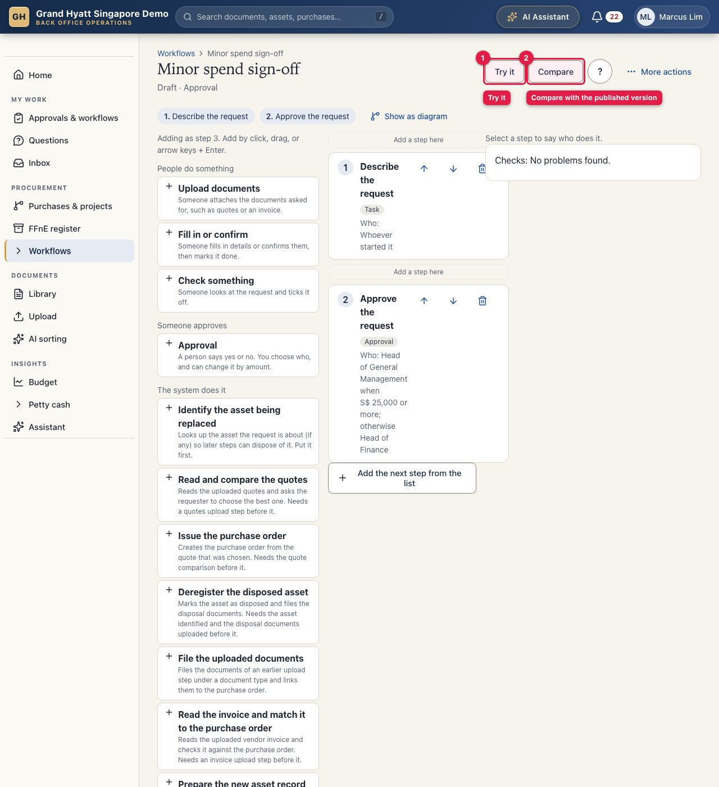

*Figure 40. The editor: Try it, Compare, Send for publishing. ① Try it. ② Compare.*

### P2. One place for approvals, and the override (3 min) · `marcus.lim`, `demo.admin`, `daniel.tan`
1. As `marcus.lim`: **Approvals & workflows** (`/approvals`). *Needs you* lists his steps and questions; the filter chips (All, AI reviewed, Overdue, Mine, Mine and my team) and the search box narrow the list. Tabs *Pipeline* (where every running request stands) and *Health* (waits, overdue, overrides).
2. **The override (live):** as `demo.admin`, *Needs you* → **Everyone** → select *Award to vendor* of "Demo: Walk-in chiller (director award pending)" (it waits for Daniel Tan) → **Approve as override** → reason "Director is travelling, award needed today" → confirm. The seal stamp appears with "Approved by Demo Administrator (as an override)".
3. Open the purchase (`/purchases/:id`, Overview): the timeline shows the **Override** pill next to the approval, with the reason. As `daniel.tan`, **Health** shows the *Overrides* count one higher (the demo data already has one override on "Minor works approval").

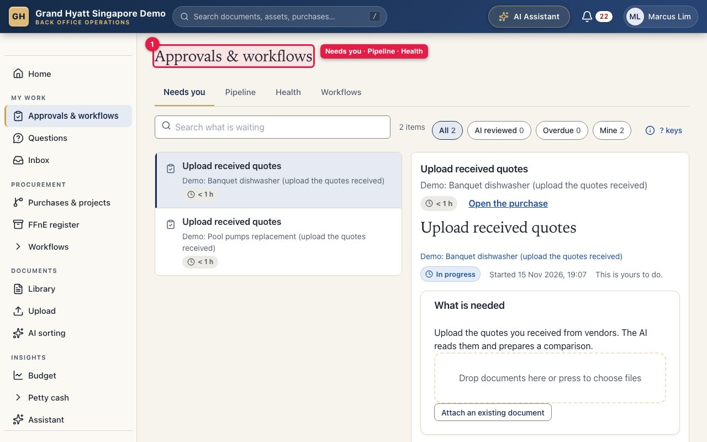

*Figure 41. Approvals & workflows: everything that waits for Marcus. ① Tabs and filters.*

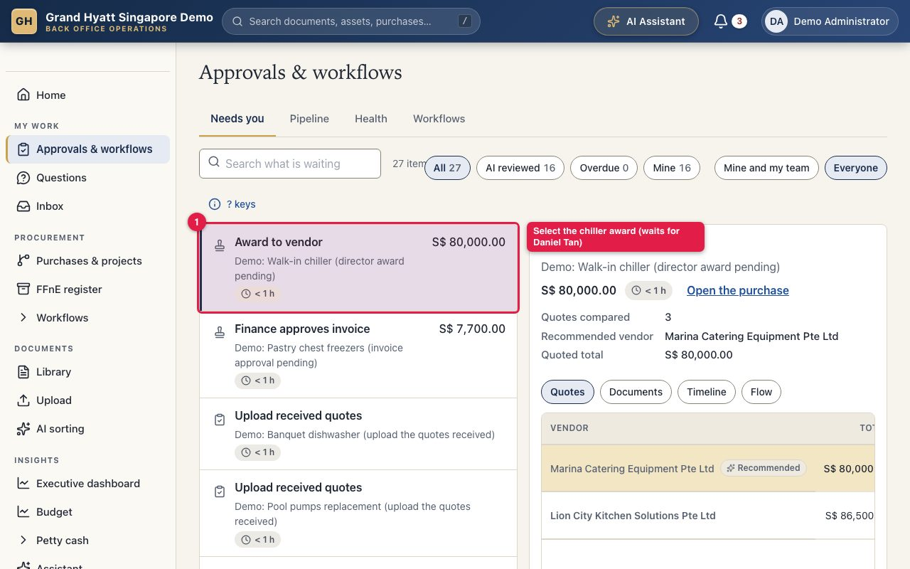

*Figure 42. Demo Administrator: Everyone -> the chiller award. ① The step.*

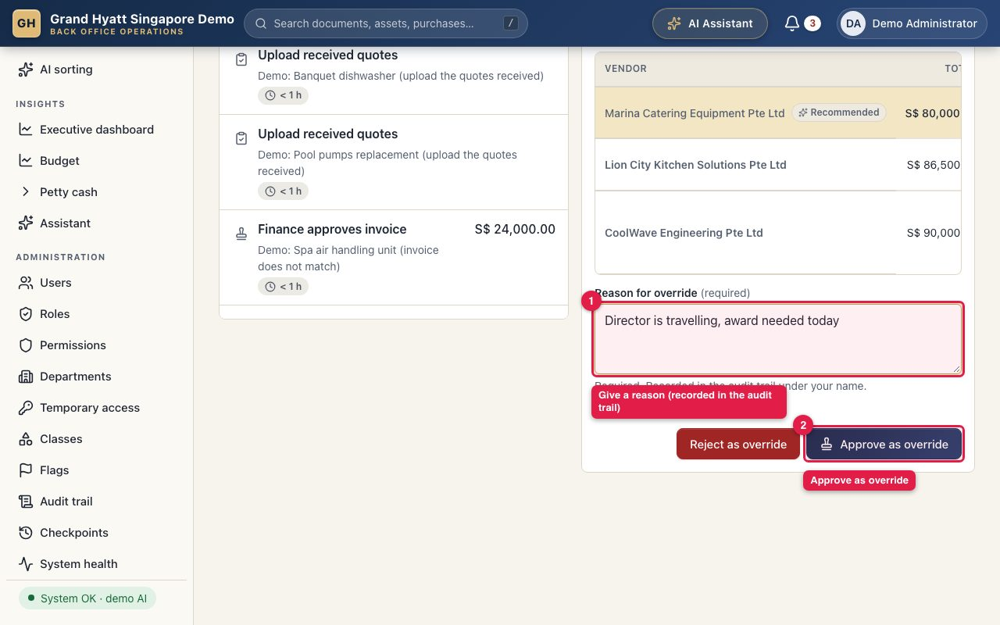

*Figure 43. The override asks for a reason. ① Reason. ② Approve as override.*

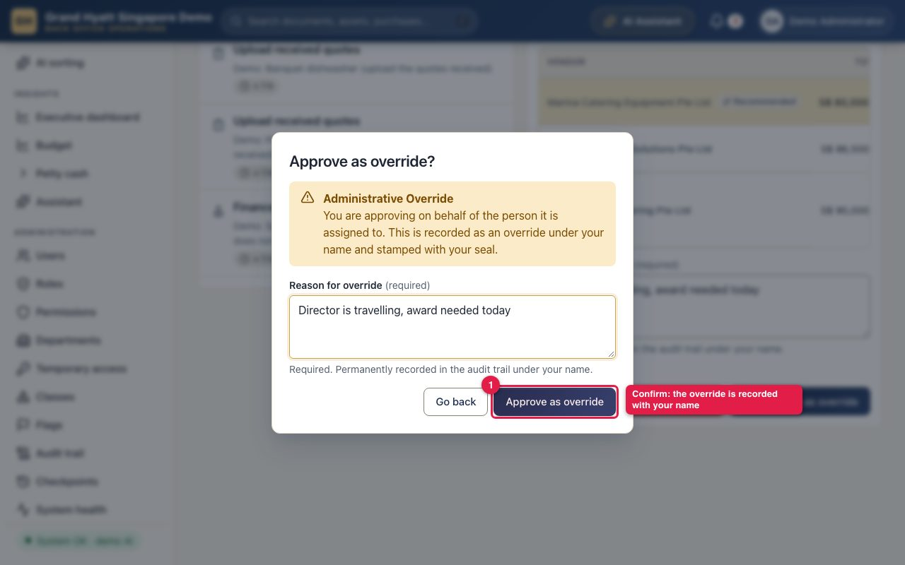

*Figure 44. A last confirmation before the override is applied. ① Confirm.*

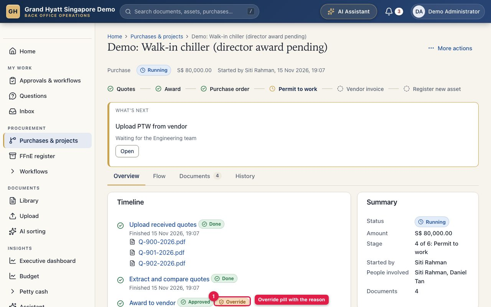

*Figure 45. The purchase timeline shows the override. ① Override pill.*

### P3. The assistant on every page (3 min) · `siti.rahman`, `grace.chua`
Open **AI Assistant** (top bar). The chip says where you are ("On: FFnE register", "On: Purchase · Demo: Washer extractor …") and the suggestions change per page.
1. On Home: "What is waiting for me?" On `/ffne`: "Take me to the assets list" → the answer offers **Go to FFnE register** (it navigates only when clicked); "Highlight the filter for me" → **Show Asset filters** highlights the filter panel. "Show only Lion City's assets" offers a filter button: the list filters through the address bar (works on every list page with filters).
2. Budget (as `grace.chua`, Director of Finance): "How much has Purchasing spent of its budget this year?" and "Which department is most over budget?": the figures match the Budget page (IT is over).
3. Refusal (as `siti.rahman`, Purchasing): "How much is the Engineering department budget for 2026?" The assistant finds no Engineering figures: it only sees what Siti may see.
4. On `/forms` (as `marcus.lim`): "Which forms can I fill in?"
Each answer takes 5-20 s with a status line.

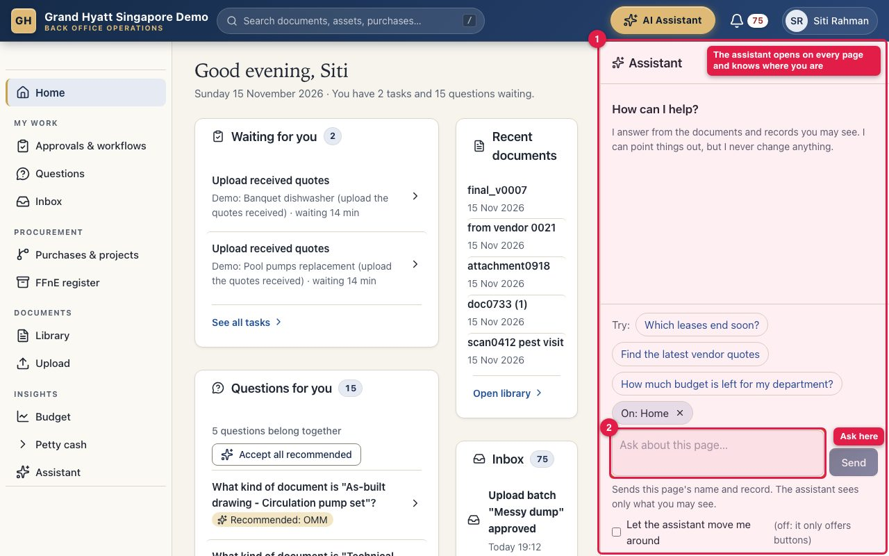

*Figure 46. AI Assistant (top bar): suggestions change per page. ① The assistant panel. ② Ask here.*

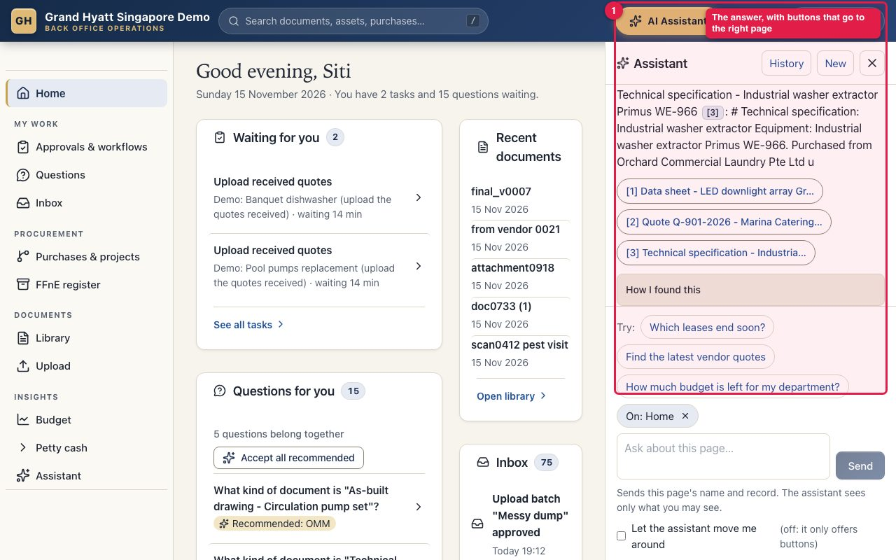

*Figure 47. An answer on the Home page. ① The answer.*

### P4. A form from a sentence (3 min) · `marcus.lim`, then `daniel.tan`
1. **Forms** (`/forms`) → **Describe a form** → "A daily minibar check per room: room number, date, bottles, cans and snacks used, restocked yes/no, room attendant, remarks, supervisor sign-off" (about 10 s). The draft opens in the designer: check the fields (Phone preview shows the 390 px form), **Save**.
2. As `daniel.tan`: **Publish**. Then **Fill in**, save a record, open **Records** → **Export CSV** downloads a CSV with plain column names.

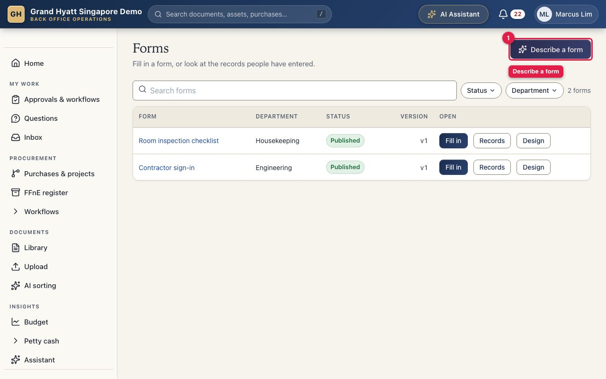

*Figure 48. Forms: the published forms and Describe a form. ① Describe a form.*

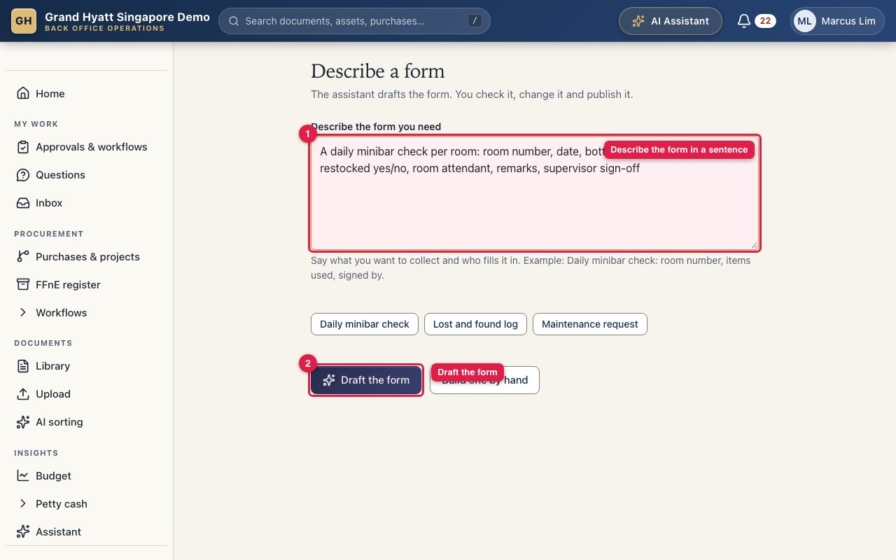

*Figure 49. Describe the form you need. ① Describe it. ② Draft the form.*

### P5. Budget and petty cash (3 min) · `grace.chua`, `janet.wong` (custodian), `marcus.lim`
1. **Insights → Budget** (`/insights/budget`): the current year (FY2026) by department, category or asset class; Spent / Committed / Surplus; the monthly trend varies by month. Click a department for the drill-down drawer (Esc closes it). IT is over budget.
2. **Import budget** (`/insights/budget/import`): upload the finance sheet, the preview lists every row with its problem before anything is saved; then **Import**.
3. **Petty cash**: as the fund's custodian **Add expense** with a receipt: small amounts post at once; an amount above the approval limit waits. As the department head approve it: the balance and ledger update.

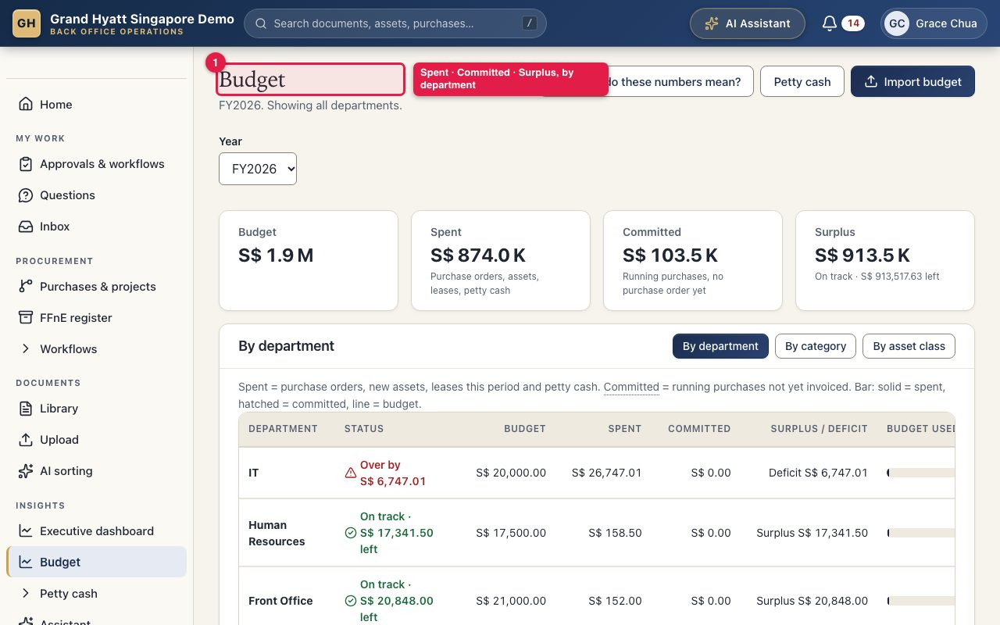

*Figure 50. Insights -> Budget: IT is over budget. ① The budget page.*

*Figure 51. Click a department for the drill-down. ① Drill-down drawer.*

*Figure 52. Import budget: preview before anything is saved. ① Import page.*

### P6. Small things that make it trustworthy (1 min)
On any document or purchase, the **History** tab says in words who changed what (a new version reads as a new version, not an empty change). On a purchase, **Attach an existing document**. **My access** shows a person's effective permissions; administrators can restore an archived document from the Library (*Archived* filter).

*Figure 53. Purchase -> History tab. ① History.*

*Figure 54. Library -> Archived filter. ① Archived documents.*

## Presenter notes: expected waits
The AI steps are slow on purpose (real models, no shortcut); each shows a status line, so the screen is never frozen. Fill the wait by explaining what happens. Measured with real keys (haiku, escalation to sonnet for doubtful documents):

| Step | Expected wait | What the screen shows | Say meanwhile |
|---|---|---|---|
| Upload: conversion on this computer | a few seconds per document; scanned PDFs about 1 s per page (local OCR) | the file appears in the batch, then in the Library | The file never leaves this computer; only its text goes to the server |
| Upload without approval, `messy-dump.zip` (32 files) | 1-2 minutes until all are filed | the Library fills folder by folder | The AI files each document; unsure ones go to *Files with low confidence* |
| Reset demo | about a minute | "Syncing demo files with the server...", then sign-in | Server data and local files return to the start together |
| Handover upload, *Mark step complete* (10 files) | 30-65 s until the 10 cards are on `/questions` | "Working…" under the buttons, then the step completes; the cards arrive in Siti's inbox | The AI reads every file and recommends its type with a reason |
| `/sorting` *Start sorting*, nightmare (the messy-dump batch) | 35-45 s | button reads "AI is sorting…", list refreshes every few seconds | It reads each document; new classes appear for what fits nothing |
| `/sorting` *Start sorting*, probable | 25-40 s | same | Only existing classes are allowed |
| Assistant, one question | 5-20 s (tool searches, then the answer) | "Thinking…" line | It searches only what the user may read; four questions took about 60 s in total |
| Prepared award/registration cards | instant (already prepared) | | |

Start a long step first, then talk; do not quit the app while "AI is working" or while uploads convert.

## If something goes wrong
- A step or card is stuck after an upload: steps wait for conversion by themselves. Use **Try this step again** only if **Home -> System health** shows a failed conversion.
- An AI answer is slow: see the waits above; do not quit the app.
- The data looks wrong, or the prepared purchases are not in their stated states: **Reset demo** as `demo.admin`.
- "Cannot connect" or **AI Off** in the bottom bar: check the internet connection; the server may be restarting (after a reset it takes about a minute). Then contact whoever runs the demo server.
- "This file is not on this computer": the document was uploaded from another computer, whose app keeps its file. The demo data opens on every computer.
- A scanned page shows no text: upload it again with **Read images and scanned pages** on.
- Settings → Document files says the folder cannot be written: the app runs from a read-only place (or from inside the zip). Unpack the zip to Documents and start it from there.
